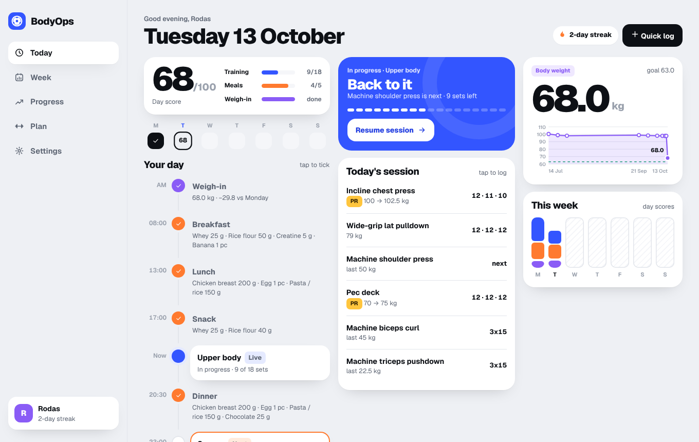
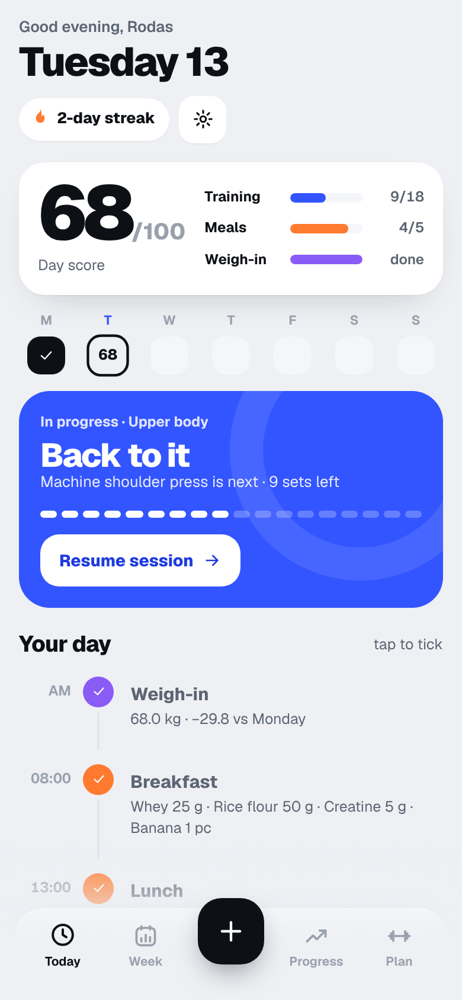
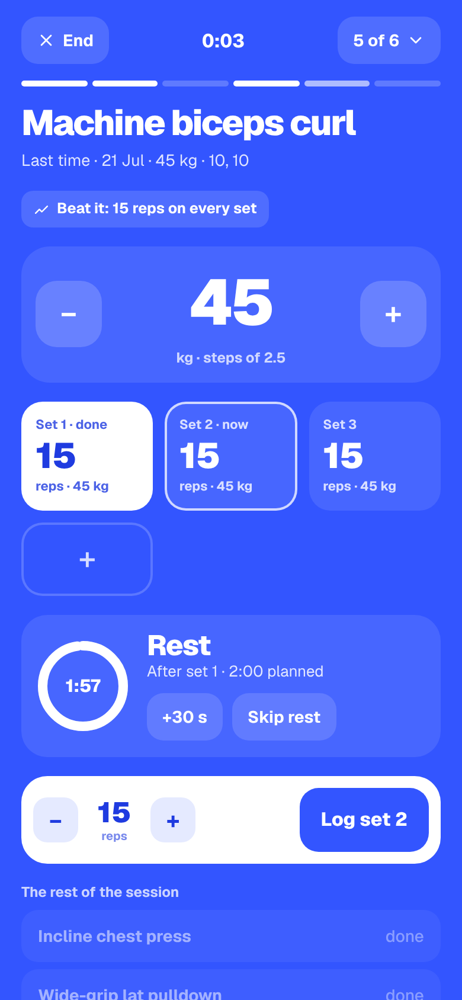

# BodyOps

Plan the week, log every set, watch the scale. BodyOps keeps a training plan, meals and weigh-ins in one place,
for as many people as you like: each account has its own plan. It runs on your own server (a NAS with Docker is
enough) and works as an app on the phone at the gym and in the browser at home.

BodyOps replaces **CorpoOps**, the single-file app with a Node sync server. Its backups import as they are
(see [Moving from CorpoOps](#moving-from-corpoops)).

| Today (computer) | Today (phone) | Session mode (phone) |
| --- | --- | --- |
|  |  |  |

## What it does

- **Today** — the day as a timeline: weigh-in, meals at their planned times and the workout, the next thing
  highlighted. One tap ticks a meal. A **day score** out of 100 (training 50, meals 35, weigh-in 15) fills as you go,
  and days scoring 60 or more in a row make a **streak**.
- **Session mode** — the workout on the whole screen, one exercise at a time: big load buttons, last time's numbers
  to beat, a tile per set, and a rest timer that starts by itself after each set (length in Settings). Lifting more
  than ever before brings up the personal record, with how far you have come.
- **Quick log** — the + button logs a weigh-in, ticks a meal or starts the workout from any screen.
- **Week** — stacked day bars (training, meals, weigh-in), the totals, the records, the sets each muscle got on the
  body map and a recap. Tap a day to tick its meals or mark the session. Reset week has Undo.
- **Progress** — body weight against the goal with the pace ("90 kg is roughly 5 months away"), every lift's best
  load and trend, and the list of records.
- **Plan** — each weekday gets a name ("Upper body"), exercises (sets × reps, notes) and meals (a time, foods in
  grams or pieces), with copy-to-other-days and drag to reorder. The muscles of each exercise are detected from its
  name (English or Portuguese) and can be picked by hand. Changes save themselves; editing the plan updates this
  week and the weeks ahead, while past weeks keep the plan they had.
- **Settings** — password, rest between sets, theme (light, dark or the device's), backup export and import, and for
  the admin, the other accounts (reset a forgotten password, delete an account).

## Run it on the NAS (Docker)

```bash
git clone https://github.com/rodrigocoelho2/bodyOps.git && cd bodyOps
cp .env.example .env          # then set SQL_SA_PASSWORD
docker network create nas-net # once, if it doesn't exist yet
docker compose up -d --build
```

Three containers start: **bodyops-sql** (SQL Server 2022 Express), **bodyops-db-deploy** (publishes
`BodyOps.Database` — creates the database the first time, applies schema changes on later deploys — and exits)
and **bodyops** (the app). Open `http://<nas-ip>:8086` and create the first account: it becomes the admin.

| Setting (`.env`) | Default | What it does |
| --- | --- | --- |
| `SQL_SA_PASSWORD` | — | SQL Server `sa` password (8+ characters, three of upper, lower, digits, symbols). |
| `SQL_PORT` | `1434` | Host port for SSMS / Azure Data Studio (`<nas-ip>,1434`, user `sa`). |
| `SQL_MEMORY_LIMIT_MB` | `1024` | Keeps SQL Server from taking most of the NAS memory. |
| `BODYOPS_PORT` | `8086` | Host port of the app. |
| `BODYOPS_ALLOW_REGISTRATION` | `true` | `false` once everyone has an account (the first account can always be created). |
| `BODYOPS_BEHIND_PROXY` | `false` | `true` when Nginx Proxy Manager sits in front (trusts `X-Forwarded-*`). |

**Nginx Proxy Manager:** the app joins `nas-net`, so a proxy host can forward to `http://bodyops:8080`
(e.g. `bodyops.prometheus-nas.com`, with the wildcard certificate). Set `BODYOPS_BEHIND_PROXY=true`.

**Updating:** `git pull && docker compose up -d --build`. The database deploy runs again and only applies what changed.

**Backups:** the data lives in the `bodyops-sql` volume. Settings › Export backup downloads one account as JSON;
for the whole server, back up the database (`BACKUP DATABASE BodyOps TO DISK = …` from SSMS) or the volume.

**Already running SQL Server for HOME Living Dex?** BodyOps can share it: drop the `sqlserver` service, point
`db-deploy`'s `SQL_SERVER` and the app's connection string at `livingdex-sql`, and put both stacks on one network.
The database is called `BodyOps`, so it never touches `LivingDex`.

## Moving from CorpoOps

1. In the old app, **Exportar backup** (or use the English copy of your data, `corpoops-backup-english.json`).
2. In BodyOps, create your account, then **Settings › Import backup** and pick the file.

The import reads CorpoOps' weekdays (`Seg` … `Dom`), meals with grams or units, exercises and hand-picked muscles,
every logged week with the plan snapshot it had, the `"3x10"` text of each exercise as three sets of 10, cardio
minutes and kilometres, the weigh-ins and the weight goal. Importing replaces the account's data and offers Undo.

## Development

### Solution layout

```
BodyOps.slnx
├── BodyOps.Database/          SQL Server project (SDK-style .sqlproj → dacpac)
│   ├── Tables/                User, UserSetting, PlanMeal, PlanFood, PlanExercise, Day, DayMeal, DayExercise, DaySet, WeightEntry
│   ├── Views/                 PlanMealSummary (a meal's foods on one line)
│   ├── StoredProcedures/      Users, Settings, Plans, Days, Weights — the only way the app touches data
│   └── Scripts/               post-deployment script and deploy.sh (used by the db-deploy container)
├── BodyOps.Library/           enums, ServiceApiResponse, validation types, header names (no ASP.NET)
├── BodyOps.WebApi/            ASP.NET Core API + the page
│   ├── Extensions/            authentication (cookie, PBKDF2), data (Dapper over stored procedures), JSON, time, messages
│   ├── Features/              Accounts, Plans, Days, Exercises, Weights, Settings, Backups, Health
│   │   └── <Feature>/         Controllers, Models (Entities, DTOs), Repositories, Services
│   └── wwwroot/               index.html, css/app.css, js/ (one file per screen), fonts, icons, manifest, service worker
├── BodyOps.UnitTest/          xUnit: services and rules with in-memory fakes, plus SQL Server integration tests
└── docs/                      README images and the HTML mocks of the interface
```

Controllers only map HTTP to services; services hold the rules and answer with `ServiceApiResponse<T>`;
repositories only call stored procedures. All user-facing text is English.

### How logged days work

A day gets a row in `dbo.Day` the first time something is ticked or logged on it, with a copy of that weekday's
plan in `dbo.DayMeal` and `dbo.DayExercise` (sets in `dbo.DaySet`). Editing the plan calls `dbo.DaySyncFromPlan`
for days from this week's Monday on, so the current week follows the plan while earlier weeks keep what they had.
Days with nothing logged show the current plan. An exercise is matched across days by its name (ignoring case and
spaces) for last time, personal records and progression.

### Running it on the PC

- Visual Studio (or `dotnet`) with the .NET 10 SDK, and a SQL Server (Docker: `docker compose up -d sqlserver db-deploy`).
- `BodyOps.WebApi/appsettings.Development.json` has the connection string (`Server=localhost,1433`, adjust the port/password).
- Run **BodyOps.WebApi** → `http://localhost:5086` (Swagger at `/swagger` in Development).

### Tests

```bash
dotnet test BodyOps.UnitTest
# SQL Server integration tests too (each test builds and drops its own database):
BODYOPS_TEST_SQL="Server=localhost,1433;User Id=sa;Password=…;TrustServerCertificate=True" dotnet test BodyOps.UnitTest
```

GitHub Actions (`.github/workflows/ci.yml`) builds everything, publishes the dacpac twice (the second publish must
change nothing), runs every test against SQL Server, then starts the Compose stack, smoke-tests it and takes
screenshots. Logs and screenshots are pushed to the `ci-output-build` and `ci-output-compose` branches.

### API

All under `/api`, JSON, cookie sign-in. Writes need the `X-BodyOps: 1` header.

| | |
| --- | --- |
| `GET health` | first run, sign-up open |
| `POST auth/register` · `auth/login` · `auth/logout` · `auth/password` · `auth/delete-account`, `GET auth/me` | account |
| `GET admin/users`, `POST admin/users/{id}/reset-password`, `DELETE admin/users/{id}` | admin only |
| `GET plan`, `PUT plan/{weekday}/meals`, `PUT plan/{weekday}/exercises`, `PUT plan/{weekday}/name`, `POST plan/{weekday}/copy` | weekday 1 = Monday |
| `GET days/week?date=`, `GET days/streak`, `GET days/consistency?weeks=` | weeks (with each day's score), the streak |
| `PUT days/{date}/meals/{planMealId}`, `PUT days/{date}/meals`, `PUT days/{date}/training`, `PUT days/{date}/exercises/{planExerciseId}` | logging (answers with the week) |
| `DELETE days/week/{date}`, `POST days/week/{date}/restore` | reset week and undo |
| `GET exercises`, `GET exercises/history?name=`, `GET exercises/records?limit=` | lifts, progression, records |
| `GET weights`, `PUT weights/{date}`, `DELETE weights/{date}`, `GET`/`PUT settings` | weight, goal and rest between sets |
| `GET backup`, `POST backup` | export, import (BodyOps or CorpoOps) |

## Licences

Font: Geist, SIL Open Font License (`BodyOps.WebApi/wwwroot/fonts`).
