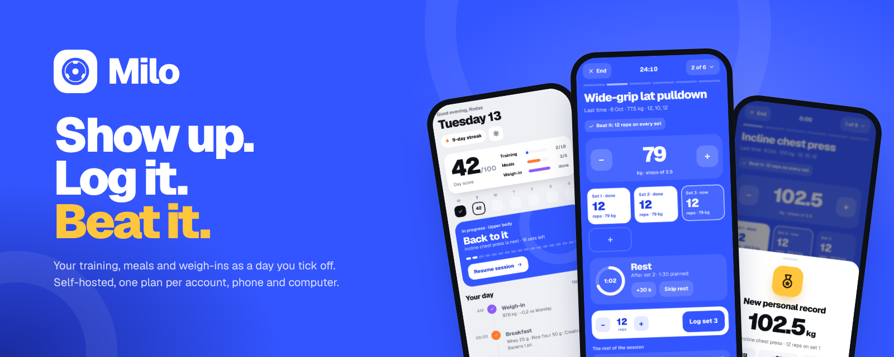
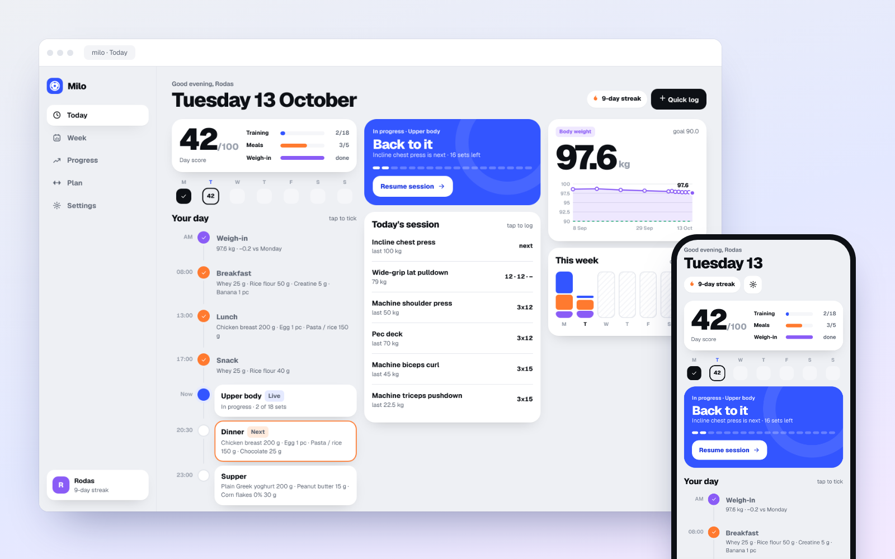
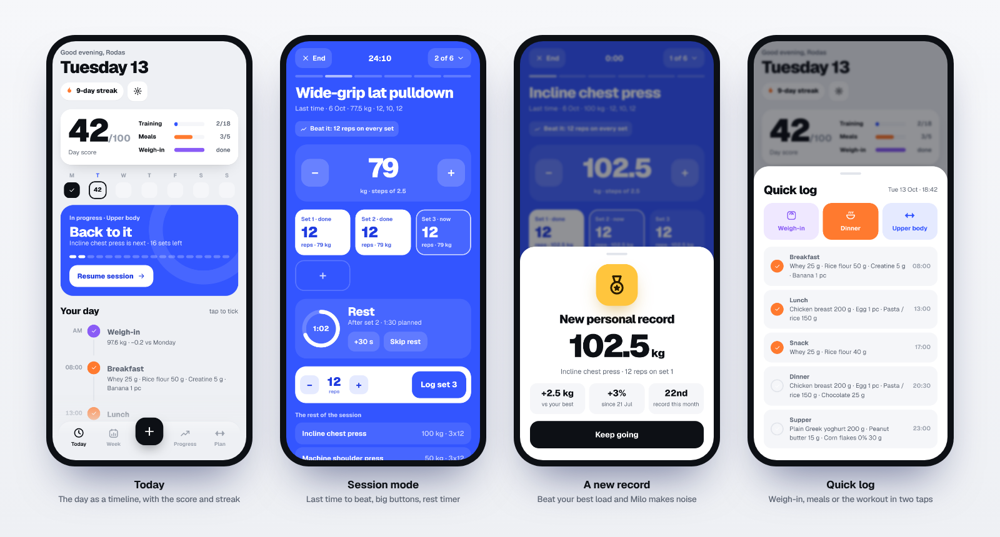
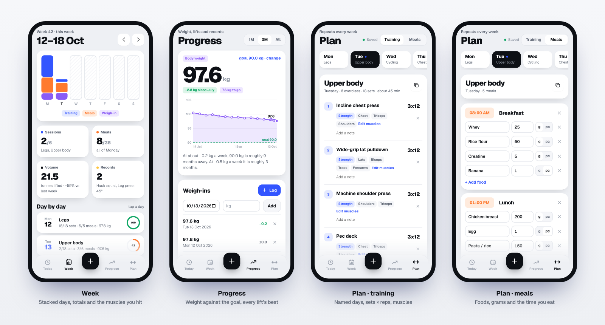
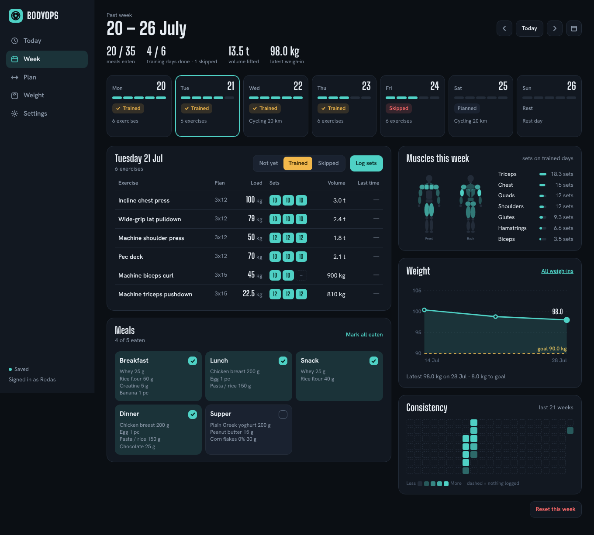
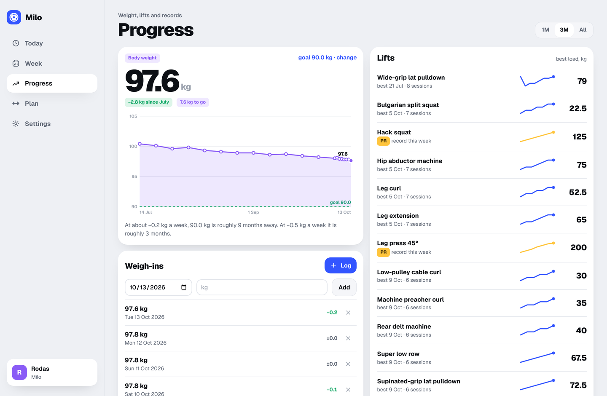
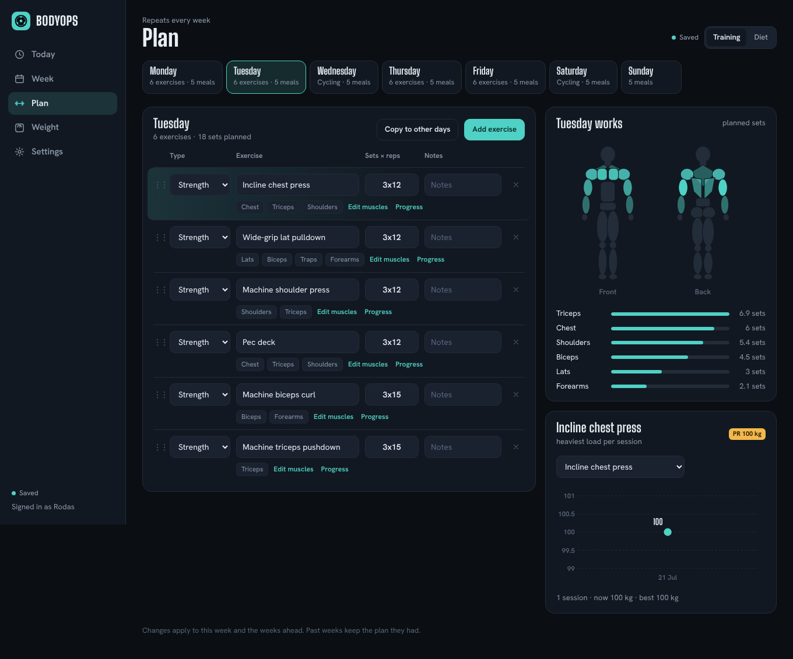
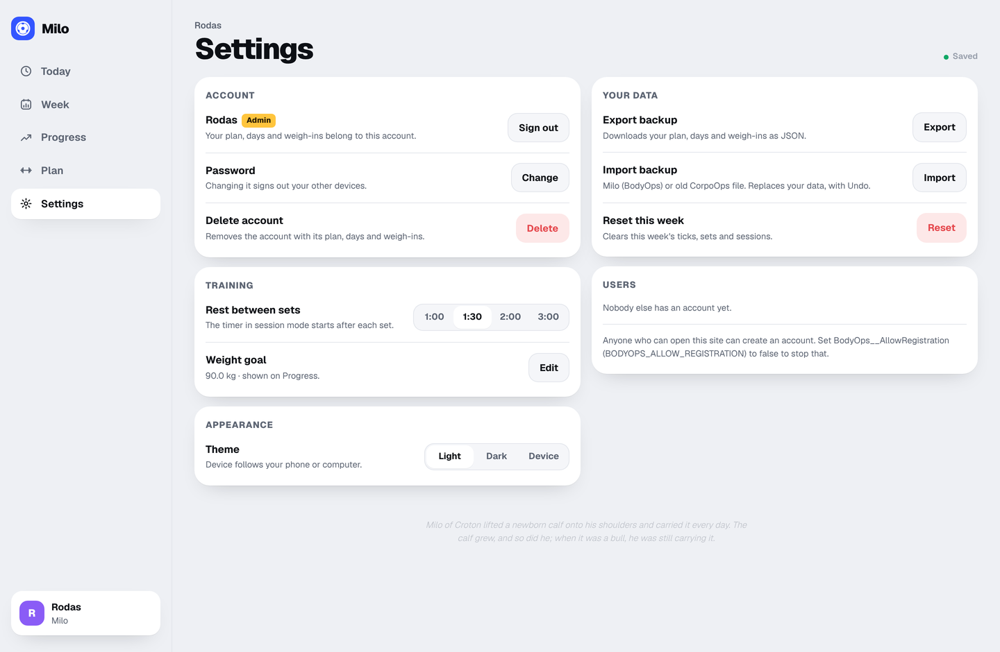
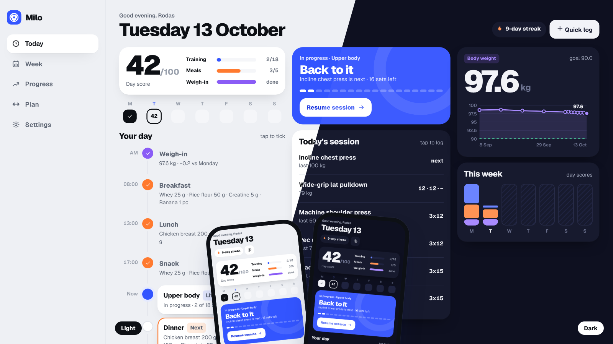
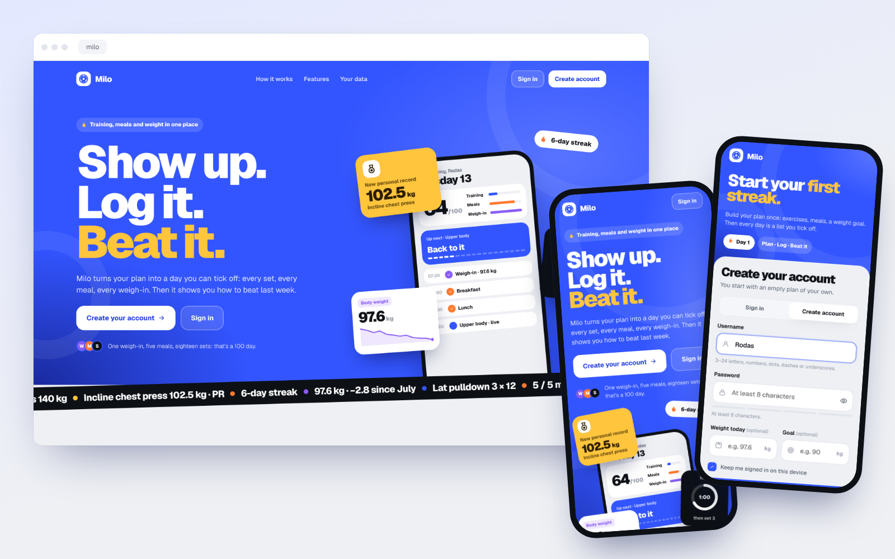

<p align="center">
  
</p>

<p align="center">
  A self-hosted <b>training, meals and weigh-in tracker</b> that turns your weekly plan into a day you tick off,<br>
  with a <b>day score</b>, a <b>streak</b>, a <b>session mode</b> for the gym floor and records that feel like records.
</p>

<p align="center">
  
  
  
  
  
</p>

<p align="center">
  <a href="#features">Features</a> ·
  <a href="#screenshots">Screenshots</a> ·
  <a href="#quick-start-docker-on-the-nas">Quick start</a> ·
  <a href="#moving-from-corpoops">From CorpoOps</a> ·
  <a href="#development">Development</a> ·
  <a href="#api">API</a>
</p>

<p align="center">
  
</p>

> Milo used to be called BodyOps, and before that CorpoOps (a single-file app). Old backups import as they are.

---

## Features

**Every day**

- **Today is a timeline**: the weigh-in, each meal at its planned time and the workout, in the order you live them.
  The next thing is highlighted and one tap ticks it off.
- **Day score and streak**: each day scores out of 100 (training 60, meals 40) and fills as you go. The weigh-in
  still shows on the timeline, the day card and the week bars, but doesn't count toward the score, so weighing in
  every week or two costs nothing.
  Days of 60 or more in a row make the streak, shown on Today, the side bar and the week.
- **Quick log**: the **+** button logs a weigh-in, ticks the next meal or starts the workout from any screen.
- **Food today**: every meal shows its calories and protein from your foods, and Today compares what you ate with
  what the day's plan adds up to. No targets to type: they come from the plan. Ate something else? Tick the meal
  with what you actually ate; the plan stays the same.
- **Weigh-in every N days**: every day, 7, 15 or 30 days. On the other days Today shows the countdown.
- **Push reminders** on the lock screen (same web push as Holo, no third party): each meal at its time with what's on
  the plate ("Ate it" ticks it without opening Milo), the workout, the weigh-in day and a streak at risk. Each phone
  turns them on once; times and which ones are in Settings. On iPhone, add Milo to the Home Screen first.

**At the gym**

- **Session mode**: the workout on the whole screen, one exercise at a time. Big load buttons in steps of 2.5 kg for
  the next set (each set keeps its own load, for progressive loading: 60 × 10, 65 × 8, 70 × 6), last time's loads
  and reps to beat, a tile per set, and the rest timer starts by itself after each set (+30 s or skip; its length is
  in Settings). It survives locking the phone and keeps the screen awake.
- **Cardio by type**: treadmill, elliptical and stairs are logged by time; bike, run, walk, rowing and swimming by
  time and distance.
- **Rep ranges and automatic progression**: write `3×8–12` and Milo pushes reps until every set reaches the top,
  then moves the weight up for next time (2.5 kg, or the step you pick per exercise) and the range starts again.
  Fixed plans like `3×10` work as before.
- **Records**: lift more than ever before and the record sheet comes up with confetti: how much more than your best,
  how far you have come since you started, and which record of the month it is. Records are also kept per rep count
  (heaviest for 3, 5, 8, 10, 12 and 15 reps), and the **estimated 1RM** (Epley) makes 70 × 12 and 75 × 8 comparable.

**The week and the long run**

- **Week**: a stacked bar per day (training and meals, with the weigh-in on top), sessions, meals, volume lifted against last week,
  records, the sets each muscle got on a body map and a recap. Tap a day to fix its meals or session.
  Reset week has Undo.
- **Progress**: body weight against your goal, with the pace ("90 kg is roughly 9 months away"), every lift's best
  load or estimated 1RM with its trend line, rep records, and the list of records.

**Your plan**

- Each weekday gets a **name** ("Upper body", "Legs"), **exercises** (sets × reps or a rep range, notes) and **meals**
  (a time, foods in grams or pieces). Copy a day to others, drag to reorder; changes save themselves.
- **My foods**: enter a label once (per 100 g or per piece) and every meal that uses it totals itself. Pick from
  Milo's built-in list of about 200 basics (USDA, public domain, works offline), search Open Food Facts or scan a
  barcode for packaged food.
- The **muscles** of each exercise are detected from its name (English or Portuguese) or picked by hand, and so is
  the **kind of cardio** ("Passadeira" is a treadmill, "Bicicleta" a bike).
- Editing the plan updates this week and the weeks ahead; past weeks keep the plan they had.

**Built to self-host**

- One `docker-compose.yml`: **SQL Server 2022 Express**, a one-shot **database deploy** (tables and stored procedures
  from a dacpac, applied again on every update) and the **app**.
- **Accounts**: everyone has their own plan and history; the first account is the admin, who can reset a forgotten
  password. Sign-ups can be closed.
- **Installs as an app** on iPhone and Android, with an offline page; light and dark themes follow the device.
- **Nothing from the internet at runtime** except what you ask for (Open Food Facts lookups, push delivery): the
  Geist font, icons and the food list ship with the app.

## Screenshots

### At the gym


### Week, progress and plan


### On the computer
<table>
<tr>
<td width="50%"><b>Week</b><br></td>
<td width="50%"><b>Progress</b><br></td>
</tr>
<tr>
<td width="50%"><b>Plan</b><br></td>
<td width="50%"><b>Settings</b><br></td>
</tr>
</table>

### Light and dark


### Welcome


<details>
<summary>Design mocks</summary>

The HTML mocks of the interface are in [`docs/mocks`](docs/mocks); open them in a browser:

- `bodyops-daylight.html`: the app, as approved (Daylight, with the Geist font)
- `bodyops-welcome.html`: the landing page with sign-in
- `milo-easter-egg.html`: the Milo of Croton line, its sheet, the offline page and the README footer
- `bodyops-first-direction.html`: the first direction, before Daylight
</details>

## Quick start (Docker on the NAS)

```bash
git clone https://github.com/rodrigocoelho2/Milo.git && cd Milo
cp .env.example .env          # then set SQL_SA_PASSWORD
docker network create nas-net # once, if it doesn't exist yet
docker compose up -d --build
```

Three containers start: **milo-sql** (SQL Server 2022 Express), **milo-db-deploy** (publishes the database project
— creates the `Milo` database the first time, applies schema changes on later deploys — and exits) and **milo**
(the app). Open `http://<nas-ip>:8086` and create the first account: it becomes the admin.

> The stack is called `milo` whatever the folder is called, so its volumes are always `milo_sql` and `milo_data`.
> The code (projects, namespaces) still uses the old name BodyOps.

| Setting (`.env`) | Default | What it does |
| --- | --- | --- |
| `SQL_SA_PASSWORD` | — | SQL Server `sa` password (8+ characters, three of upper, lower, digits, symbols). |
| `SQL_PORT` | `1434` | Host port for SSMS / Azure Data Studio (`<nas-ip>,1434`, user `sa`). |
| `SQL_MEMORY_LIMIT_MB` | `1024` | Keeps SQL Server from taking most of the NAS memory. |
| `MILO_PORT` | `8086` | Host port of the app. |
| `MILO_ALLOW_REGISTRATION` | `true` | `false` once everyone has an account (the first account can always be created). |
| `MILO_BEHIND_PROXY` | `false` | `true` when Nginx Proxy Manager sits in front (trusts `X-Forwarded-*`). |
| `MILO_PUSH_ENABLED` | `true` | `false` turns push reminders off. |
| `MILO_PUSH_SUBJECT` | the repo URL | How the browsers' push services can reach you (`mailto:you@example.com` or an https URL). |

The older `BODYOPS_PORT`, `BODYOPS_ALLOW_REGISTRATION` and `BODYOPS_BEHIND_PROXY` still work.

**Nginx Proxy Manager:** the app joins `nas-net`, so a proxy host can forward to `http://milo:8080`
(with your wildcard certificate). Set `MILO_BEHIND_PROXY=true`.

**Updating:** `git pull && docker compose up -d --build`. The database deploy runs again and only applies what changed.

**Backups:** the data lives in the `milo_sql` volume. Settings › Export backup downloads one account as JSON;
for the whole server, back up the database (`BACKUP DATABASE Milo TO DISK = …` from SSMS) or the volume.

**Already running SQL Server for HOME Living Dex?** Milo can share it: drop the `sqlserver` service, point
`db-deploy`'s `SQL_SERVER` and the app's connection string at `livingdex-sql`, and put both stacks on one network.
The database is called `Milo`, so it never touches `LivingDex`.

## Moving from CorpoOps

1. In the old app, **Exportar backup** (or use the English copy of your data, `corpoops-backup-english.json`).
2. In Milo, create your account, then **Settings › Import backup** and pick the file.

The import reads CorpoOps' weekdays (`Seg` … `Dom`), meals with grams or units, exercises and hand-picked muscles,
every logged week with the plan snapshot it had, the `"3x10"` text of each exercise as three sets of 10, cardio
minutes and kilometres, the weigh-ins and the weight goal. Importing replaces the account's data and offers Undo.

## Development

### Solution layout

```
BodyOps.slnx
├── BodyOps.Database/          SQL Server project (SDK-style .sqlproj → dacpac)
│   ├── Tables/                User, UserSetting, PlanDay, PlanMeal, PlanFood, PlanExercise, Day, DayMeal, DayExercise, DaySet, WeightEntry
│   ├── Views/                 PlanMealSummary (a meal's foods on one line)
│   ├── StoredProcedures/      Users, Settings, Plans, Days, Weights — the only way the app touches data
│   └── Scripts/               post-deployment script and deploy.sh (used by the db-deploy container)
├── BodyOps.Library/           enums, ServiceApiResponse, validation types, header names (no ASP.NET)
├── BodyOps.WebApi/            ASP.NET Core API + the page
│   ├── Extensions/            authentication (cookie, PBKDF2), data (Dapper over stored procedures), JSON, time, messages
│   ├── Features/              Accounts, Plans, Days, Exercises, Weights, Settings, Backups, Health
│   │   └── <Feature>/         Controllers, Models (Entities, DTOs), Repositories, Services
│   └── wwwroot/               index.html, css/app.css, js/ (one file per screen), fonts, icons, manifest, service worker
├── BodyOps.UnitTest/          xUnit: services and rules with in-memory fakes, plus SQL Server integration tests
└── docs/                      README images and the HTML mocks of the interface
```

Controllers only map HTTP to services; services hold the rules and answer with `ServiceApiResponse<T>`;
repositories only call stored procedures. All user-facing text is English.

### How logged days work

A day gets a row in `dbo.Day` the first time something is ticked or logged on it, with a copy of that weekday's
plan in `dbo.DayMeal` and `dbo.DayExercise` (sets in `dbo.DaySet`). Editing the plan calls `dbo.DaySyncFromPlan`
for days from this week's Monday on, so the current week follows the plan while earlier weeks keep what they had.
Days with nothing logged show the current plan. An exercise is matched across days by its name (ignoring case and
spaces) for last time, personal records and progression.

### Running it on the PC

- Visual Studio (or `dotnet`) with the .NET 10 SDK, and a SQL Server (Docker: `docker compose up -d sqlserver db-deploy`).
- `BodyOps.WebApi/appsettings.Development.json` has the connection string (`Server=localhost,1433`, adjust the port/password).
- Run **BodyOps.WebApi** → `http://localhost:5086` (Swagger at `/swagger` in Development).

### Tests

```bash
dotnet test BodyOps.UnitTest
# SQL Server integration tests too (each test builds and drops its own database):
BODYOPS_TEST_SQL="Server=localhost,1433;User Id=sa;Password=…;TrustServerCertificate=True" dotnet test BodyOps.UnitTest
```

GitHub Actions (`.github/workflows/ci.yml`) builds everything, publishes the dacpac twice (the second publish must
change nothing), runs every test against SQL Server, then starts the Compose stack, smoke-tests it and takes
screenshots. Logs and screenshots are pushed to the `ci-output-build` and `ci-output-compose` branches.

### API

All under `/api`, JSON, cookie sign-in. Writes need the `X-BodyOps: 1` header.

| | |
| --- | --- |
| `GET health` | first run, sign-up open |
| `POST auth/register` · `auth/login` · `auth/logout` · `auth/password` · `auth/delete-account`, `GET auth/me` | account |
| `GET admin/users`, `POST admin/users/{id}/reset-password`, `DELETE admin/users/{id}` | admin only |
| `GET plan`, `PUT plan/{weekday}/meals`, `PUT plan/{weekday}/exercises`, `PUT plan/{weekday}/name`, `POST plan/{weekday}/copy` | weekday 1 = Monday |
| `GET days/week?date=`, `GET days/streak`, `GET days/consistency?weeks=` | weeks (with each day's score), the streak |
| `PUT days/{date}/meals/{planMealId}`, `PUT days/{date}/meals`, `PUT days/{date}/training`, `PUT days/{date}/exercises/{planExerciseId}` | logging (answers with the week) |
| `DELETE days/week/{date}`, `POST days/week/{date}/restore` | reset week and undo |
| `GET exercises`, `GET exercises/history?name=`, `GET exercises/records?limit=` | lifts, progression, records |
| `GET weights`, `PUT weights/{date}`, `DELETE weights/{date}`, `GET`/`PUT settings` | weight, goal, rest, weigh-in interval, reminders |
| `GET`/`POST foods`, `PUT`/`DELETE foods/{id}`, `GET foods/search?q=`, `GET foods/packaged?q=`, `GET foods/barcode/{code}` | your foods, the built-in list, Open Food Facts |
| `GET push`, `POST push/subscribe` · `push/unsubscribe` · `push/test` | push reminders on this device |
| `GET backup`, `POST backup` | export, import (Milo/BodyOps or CorpoOps) |

## Licences

Font: Geist, SIL Open Font License (`BodyOps.WebApi/wwwroot/fonts`).

<br>
<p align="center">
  <picture>
    <source media="(prefers-color-scheme: dark)" srcset="docs/images/milo-ink-light.png">
    
  </picture>
</p>
<p align="center"><sub><i>Milo of Croton lifted a newborn calf onto his shoulders and carried it every day. The calf grew, and so did he.</i></sub></p>
